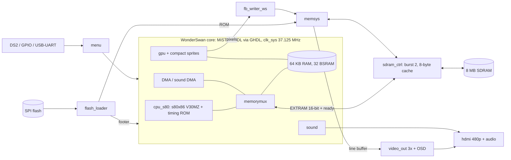

# Architecture

## What changed in the MiSTer core (`rtl/ws`)

| File | Change |
|---|---|
| `swanTop.vhd` | the CPU is the black box `cpu_s80`; new port `EXTRAM_ready` (the CPU waits for the SDRAM) |
| `sprites.vhd` | rewritten: loads go into a FIFO and are rendered into a ping-pong line buffer (1 BSRAM), which is cleared after `clearNext` |
| `savestates.vhd`, `statemanager.vhd` | stubs; only the reset behaviour is kept |
| `rtc.vhd`, `serial.vhd` | stubs |
| `eeprom.vhd` | the internal EEPROM is cut to 64 words |
| `memorymux.vhd`, `dpram.vhd` | palette RAM as one 16-bit memory in LUT RAM; portable `dpram` instead of `altsyncram` |
| `swanbios*.vhd` | the open boot stub (`tools/make_bootstub.py`) instead of the Bandai IPL |
| `ws_core.vhd` | wrapper with only the ports the board uses |

## Boot stub

The CPU starts at `FFFF:0000`, inside the boot ROM window. The stub then:

1. jumps to `F000:FF00`;
2. sets up a stack;
3. copies `out 0xA0, al / jmp far FFFF:0000` to RAM `0000:0100` and jumps there.

Writing bit 0 of port `0xA0` unmaps the boot ROM, so the far jump lands in the cartridge's own entry point. The copyrighted Bandai IPL is not needed. The boot logo and the owner-name screen are skipped.

## Fitting into the GW2AR-18

| Step | LUT (yosys) | BSRAM |
|---|---|---|
| MiSTer core alone | 21 900 | 68 → 37 with `no_rw_check` |
| + s80x86 instead of the MiSTer CPU | −7 000 | +7 (microcode, timing ROM) |
| RTC / serial stubs, compact divider | −1 100 | |
| compact sprite unit | −4 100 | +1 |
| palette and OSD sharing, smaller EEPROM | | −4 |
| **whole system with HDMI, menu, SDRAM** | **15 685 LUT4 (75%)** after placement | **45 / 46** |
